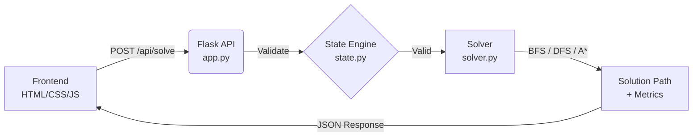

# 🧪 Water Sort Puzzle Solver

<div align="center">


**AI-powered web application to solve the Water Sort Puzzle using search algorithms.**

</div>

---

## 📖 Overview

Water Sort Puzzle Solver is a full-stack web application that models the popular puzzle game as an AI search problem. It features a **Flask REST API** backend implementing three graph search algorithms (**BFS**, **DFS**, and **A\***) with a custom **Color Breaks heuristic**, paired with an interactive **Vanilla JS** frontend for visualizing the solution step-by-step.

> This project was developed as an Artificial Intelligence coursework assignment, referencing the Makalah IF2211 paper on A* applications for Water Sort Puzzle.

---

## ✨ Features

- **Interactive UI**: Create custom boards by clicking tubes and selecting colors.
- **3 Search Algorithms**: Compare BFS (optimal), DFS (fast), and A* (heuristic-guided).
- **Advanced A* Heuristic**: Implements **Color Breaks** (counting color transitions from bottom to top per tube) instead of naive incomplete-tube counting.
- **Strict Validation**: 3-layer validation ensures only physically legal boards are solved.
- **Step-by-Step Playback**: Next/Prev buttons and AutoPlay mode (0.5s interval) to visualize the pouring process.
- **Metrics Tracking**: Returns both the solution path and the number of states checked (`state_checked`) for algorithm comparison.

---

## 🏗️ Architecture



### Project Structure

```
water_sort_project/
├── backend/
│   ├── app.py              # Flask API server & CORS setup
│   ├── solver.py           # BFS, DFS, A* implementations
│   ├── state.py            # WaterSortState class & validation logic
│   └── test_game.py        # 6 unit test cases
├── frontend/
│   ├── index.html          # Main UI layout
│   ├── script.js           # Client-side logic & API integration
│   └── style.css           # Responsive styling
├── .gitignore
├── LICENSE                 # MIT License
├── README.md               # This file
├── GIAI_THICH_GIAI_THUAT.md # Algorithm deep-dive (Vietnamese)
├── HUONG_DAN_CODE_WATER_SORT.md # Code documentation (Vietnamese)
└── requirements.txt        # Python dependencies
```

---

## 🚀 Getting Started

### Prerequisites

- Python 3.10+
- Modern web browser (Chrome, Firefox, Edge)

### Installation

1. **Clone the repository:**
   ```bash
   git clone https://github.com/hiencode-rea/water_sort_project.git
   cd water_sort_project
   ```

2. **Install Python dependencies:**
   ```bash
   pip install -r requirements.txt
   ```

3. **Start the Backend server:**
   ```bash
   cd backend
   python app.py
   ```
   *Server will run at `http://localhost:5000`*

4. **Open the Frontend:**
   Open `frontend/index.html` directly in your browser, or use VS Code's **Live Server** extension.

   > ⚠️ Press `Ctrl + F5` to hard refresh if UI changes don't appear.

---

## 🎮 How to Use

### Creating a Board

1. Select the number of tubes (default: 4).
2. Select the capacity per tube (default: 4, max: 10).
3. Click **"Tạo ống rỗng"** (Create empty tubes).
4. Pick a color from the palette below.
5. Click on a tube to pour that color into it.
6. Ensure each color appears exactly `capacity` times across the board.

### Solving

1. Choose an algorithm: **BFS**, **DFS**, or **A\***.
2. Click **"GIẢI"** (Solve).
3. Results:
   - ✅ **Success**: Shows total steps and the move list.
   - ❌ **Invalid**: Board violates game rules (wrong color count, overflow, etc.).
   - ⚠️ **No Solution**: No valid path exists to reach the goal state.

### Playback Controls

| Button | Action |
|--------|--------|
| **Next Step** | Advance 1 move forward |
| **Prev Step** | Rewind 1 move backward |
| **Auto Play** | Automatically play through all steps (0.5s delay) |

---

## 🧠 Algorithms Deep Dive

All solvers return a tuple: `(solution_path, states_checked)`.

| Algorithm | Data Structure | Optimality | Space Complexity | Strategy |
|-----------|---------------|------------|------------------|----------|
| **BFS** | `collections.deque` (FIFO) | ✅ Yes (shortest path) | O(b^d) | Explores level by level |
| **DFS** | `list` (LIFO Stack) | ❌ No | O(b·d) | Goes deep before backtracking |
| **A\*** | `heapq` (Priority Queue) | ✅ Yes (if h is admissible) | O(b^d) | f(n) = g(n) + h(n) |

### A* Heuristic: Color Breaks

Instead of simply counting incomplete tubes, our A* implementation uses the **Color Breaks** heuristic based on the Makalah IF2211 paper:

```python
def count_color_breaks(state):
    h = 0
    for tube in state.tubes:
        colors = [c for c in tube if c != '']
        for i in range(1, len(colors)):
            if colors[i] != colors[i-1]:
                h += 1  # Each color transition = 1 break
    return h
```

- **Intuition**: A completed tube has 0 breaks. Every color change inside a tube represents at least 1 required pour to separate them.
- **Admissibility**: Since each break requires at least one move to resolve, `h(n) <= actual_cost`, making it admissible and guaranteeing optimal solutions.
- **closedList**: Implemented as a `dict` mapping `str(tubes) -> min_g_cost` rather than a simple `set`, allowing re-exploration if a shorter path to the same state is found.

---

## 🔌 API Reference

### `POST /api/solve`

**Request Body:**
```json
{
  "tubes": [
    ["#2ecc71", "#f1c40f", "", ""],
    ["#f1c40f", "#2ecc71", "", ""],
    ["#2ecc71", "#2ecc71", "", ""],
    ["#f1c40f", "#f1c40f", "", ""]
  ],
  "capacity": 4,
  "algorithm": "astar"
}
```

**Success Response (200):**
```json
{
  "status": "success",
  "total_steps": 4,
  "states_checked": 6,
  "solution_path": [
    [0, 3, 1, "#f1c40f"],
    [0, 1, 1, "#2ecc71"],
    [1, 2, 2, "#2ecc71"],
    [1, 3, 1, "#f1c40f"]
  ]
}
```
*Note: `solution_path` items are `[source_idx, dest_idx, amount, color]`*

**Error Responses:**
```json
{"status": "invalid", "error": "Mỗi màu phải có đúng 4 nấc: '#2ecc71' có 3/4 nấc."}
{"status": "no_solution", "message": "Khong tim thay loi giai"}
```

---

## ✅ Validation Rules

Before solving, the backend enforces strict game rules via `state.py`:

1. Minimum 2 tubes required.
2. Capacity must be between 1 and 10.
3. No tube can exceed its capacity.
4. Colors must be stacked contiguously from the bottom (no empty gaps below colors).
5. Every distinct color must appear exactly `capacity` times.
6. Algorithm parameter must be `bfs`, `dfs`, or `astar`.

---

## 🧪 Testing

Run the unit test suite (6 test cases covering basic rules, consecutive blocks, screenshot states, validation, and all 3 algorithms):

```bash
cd backend
python test_game.py
```

Expected output: All 6 tests passing, confirming correct tuple unpacking `(path, state_checked)` and move generation logic.

---

## 🛠️ Tech Stack

| Layer | Technology |
|-------|-----------|
| **Backend** | Python 3.x, Flask, Flask-CORS |
| **Frontend** | HTML5, CSS3, Vanilla JavaScript (ES6+) |
| **AI/Search** | Custom BFS/DFS/A* with `collections.deque` & `heapq` |
| **State Repr.** | Immutable Tuples (hashable for `set`/`dict` lookups) |

---

## 📄 License

This project is licensed under the MIT License - see the [LICENSE](LICENSE) file for details.

---

## 👤 Author

Developed as an Artificial Intelligence course project.

<div align="center">
Made with ❤️ for AI Search Algorithm study
</div>
